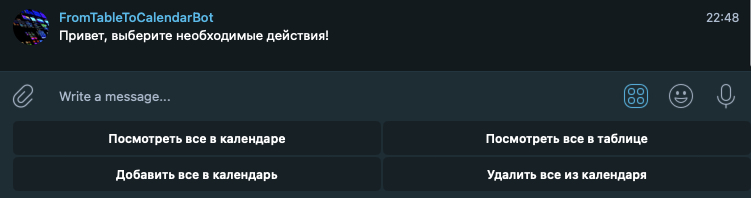
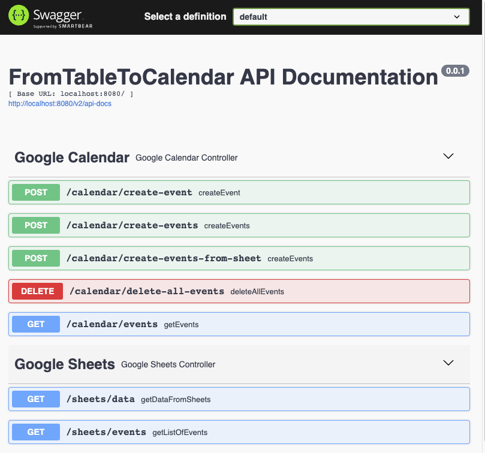

# University Schedule

Telegram bot that synchronizes a university schedule from Google Sheets to Google Calendar.

My university published the class schedule in a Google Sheet. I wanted new classes to automatically appear in my personal calendar so I could see them directly on my Apple Watch without manually checking the spreadsheet.  
This project was built to automatically convert the schedule from Google Sheets into Google Calendar events.

## Features

- Fetch schedule data from Google Sheets
- Process and structure class schedule
- Create events in Google Calendar
- Manage synchronization through a Telegram bot

## Tech

- Java
- Spring
- Google Sheets API
- Google Calendar API
- Telegram Bot API

## Screenshots

## Author

Andrei Gavrilenko  
https://github.com/Gaavr
